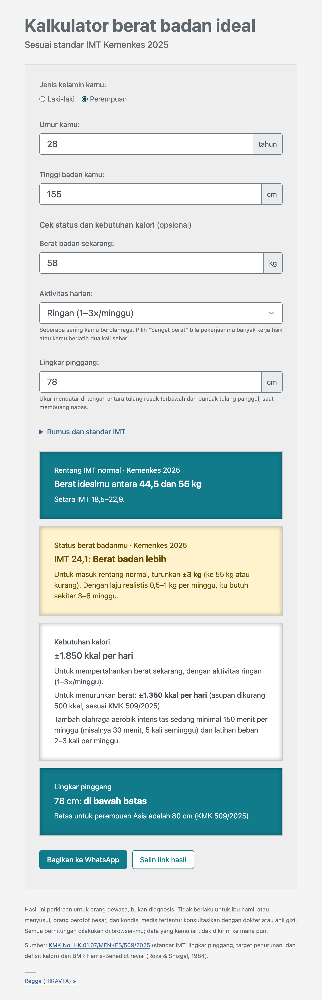

# Kalkulator Berat Badan Ideal

Kalkulator berat badan ideal untuk orang dewasa Indonesia, lengkap dengan status IMT, target yang realistis, dan kebutuhan kalori. Standarnya mengikuti pedoman Kemenkes 2025 (klasifikasi Asia-Pasifik), dengan enam rumus klasik sebagai pembanding: Devine, Robinson, Miller, Hamwi, Lemmens, dan Broca.

**Coba langsung:** https://reggarantai.github.io/kalkulator-berat-badan-ideal/



## Fitur

- **Standar IMT Kemenkes 2025** (normal 18,5–22,9) sebagai bawaan, dengan WHO global (18,5–24,9) sebagai pilihan.
- **Status dan target.** Isi berat badan untuk melihat kategori IMT, berapa kg menuju rentang normal, dan perkiraan waktunya.
- **Kebutuhan kalori** harian dan saran asupan untuk menurunkan berat, dengan batas minimum yang aman.
- **Lingkar pinggang** untuk mengecek obesitas sentral dengan batas Asia-Pasifik.
- **Enam rumus klasik**, masing-masing dengan IMT setaranya. Hasil yang jatuh di luar rentang normal diberi tanda.
- **Tidak memaksakan rumus.** Devine, Robinson, Miller, dan Hamwi hanya terdefinisi untuk tinggi 152,4 cm (5 kaki) ke atas, jadi tidak dipakai di bawah itu.
- **Cek umur.** Di bawah 18 tahun diarahkan ke standar antropometri anak; di atas 65 tahun diberi catatan khusus.
- **Bagikan.** Tombol WhatsApp hanya mengirim rentang berat ideal. "Salin link hasil" menyimpan isian di fragmen URL (`#…`), yang tidak pernah dikirim ke server.
- **Bisa di-install dan dipakai offline** sebagai PWA.
- **Privat.** Semua dihitung di browser; data yang diisi tidak dikirim ke mana pun.
- **Tanpa dependency.** HTML, CSS, dan JavaScript murni, tanpa framework, CDN, maupun build.

## Standar IMT

| Kategori | Kemenkes 2025 (Asia-Pasifik) | WHO global |
|---|---|---|
| Berat badan kurang | < 18,5 | < 18,5 |
| Normal | 18,5–22,9 | 18,5–24,9 |
| Berat badan lebih | 23–24,9 | 25–29,9 |
| Obesitas | ≥ 25 (I: 25–29,9 · II: ≥ 30) | ≥ 30 |

Sumber: [KMK No. HK.01.07/MENKES/509/2025](https://keslan.kemkes.go.id/unduhan/KMK%20No.%20HK.01.07-MENKES-509-2025.pdf) tentang Pedoman Nasional Pelayanan Klinis Tata Laksana Obesitas Dewasa (Tabel 3.1), dan WHO (2000).

## Rumus

| Rumus | Laki-laki | Perempuan | Rujukan |
|---|---|---|---|
| Devine | 50 kg + 2,3 kg per inci di atas 5 kaki | 45,5 kg + 2,3 kg per inci | Devine, *Drug Intell Clin Pharm*, 1974 |
| Robinson | 52 kg + 1,9 kg per inci | 49 kg + 1,7 kg per inci | Robinson dkk., *Am J Hosp Pharm*, 1983 |
| Miller | 56,2 kg + 1,41 kg per inci | 53,1 kg + 1,36 kg per inci | Miller dkk., *Am J Hosp Pharm*, 1983 |
| Hamwi | 106 lb + 6 lb per inci | 100 lb + 5 lb per inci | Hamwi, *Diabetes Mellitus: Diagnosis and Treatment*, 1964 |
| Lemmens | 22 × tinggi (m)² | 22 × tinggi (m)² | Lemmens dkk., *Obes Surg*, 2005 |
| Broca | (tinggi − 100) − 10% | (tinggi − 100) − 15% | Paul Broca, abad ke-19 |

Hasil Hamwi berlaku untuk rangka tubuh sedang; kurangi 10% untuk rangka kecil dan tambah 10% untuk rangka besar.

## Status, target, dan kalori

| Bagian | Cara hitung | Sumber |
|---|---|---|
| Target awal (obesitas) | Turun 5–10% berat badan dalam 6 bulan pertama | KMK 509/2025 |
| Perkiraan waktu | Laju realistis 0,5–1 kg per minggu | KMK 509/2025 |
| Kebutuhan kalori | BMR Harris-Benedict revisi × faktor aktivitas (1,2–1,9) | Roza & Shizgal, *Am J Clin Nutr*, 1984; KMK 509/2025 memakai Harris-Benedict |
| Kalori untuk turun berat | Kebutuhan harian dikurangi 500 kkal, tidak di bawah 1.200 kkal (perempuan) atau 1.500 kkal (laki-laki) | KMK 509/2025; [Harvard Health Publishing, 2024](https://www.health.harvard.edu/staying-healthy/calorie-counting-made-easy) |
| Aktivitas fisik | Aerobik intensitas sedang minimal 150 menit per minggu, latihan beban 2–3 kali per minggu | KMK 509/2025, Tabel 3.10 |
| Obesitas sentral | Lingkar pinggang > 90 cm (laki-laki) atau > 80 cm (perempuan) | KMK 509/2025, Tabel 3.2 |

## Batasan

Hasilnya perkiraan untuk orang dewasa, bukan diagnosis. Tidak berlaku untuk ibu hamil atau menyusui, orang berotot besar, dan kondisi medis tertentu. Konsultasikan dengan dokter atau ahli gizi.

## Pengembangan

Tidak ada dependency dan tidak perlu build. Buka `index.html` langsung di browser.

```
index.html            halaman kalkulator
manifest.webmanifest  manifest PWA
sw.js                 service worker untuk mode offline
assets/css/style.css  tampilan
assets/js/rumus.js    rumus dan logika murni (tanpa DOM), bisa dipakai ulang
assets/js/script.js   interaksi form
assets/img/           ikon dan gambar pratinjau link (OG)
tests/                unit test (node:test)
```

Jalankan tes (Node.js 20+):

```bash
npm test
```

Setiap push ke `main` menjalankan tes lalu men-deploy ke GitHub Pages lewat `.github/workflows/pages.yml`.

## Latar belakang

Proyek ini awalnya dibuat untuk tutorial [Membuat kalkulator untuk menghitung berat badan ideal](https://regga.id/coding/membuat-kalkulator-berat-badan-ideal/) (2021). Versi jQuery yang dibahas di artikel itu masih bisa dilihat di commit [`e200960`](https://github.com/reggarantai/kalkulator-berat-badan-ideal/tree/e200960).

## Lisensi

[MIT](LICENSE) © Regga Rantai
